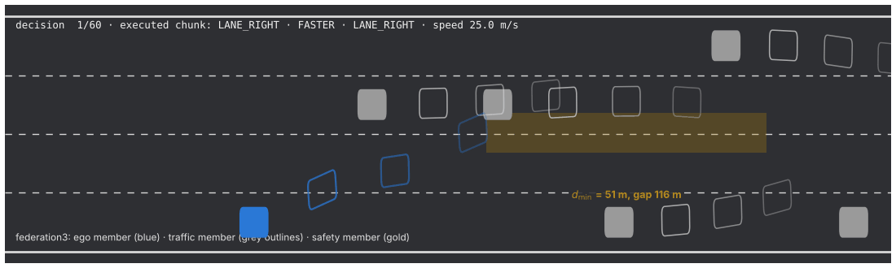
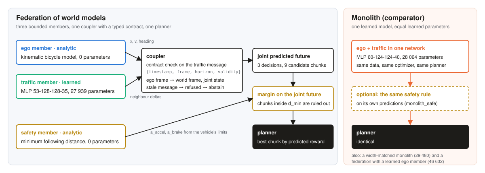
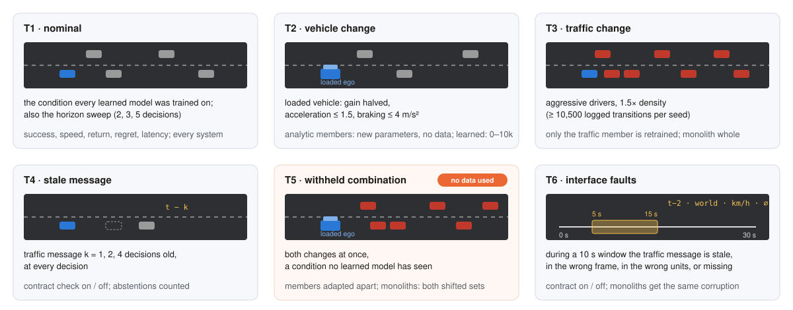

# fwm-driving — a federation of world models for highway driving

**Brownstafford Abraham (Everyday Intelligence) · Katerina Vinciguerra (University of Parma)**
*A Federation of World Models for Robots: Predictive Responsibility, Composition, and Evaluation* — Do Robots Need World Models? workshop, CoRL 2026.


## The paper in one minute

[](media/fwm_one_minute.mp4)

*Click the image for the narrated video ([`media/fwm_one_minute.mp4`](media/fwm_one_minute.mp4), 1920×1080, 61 s). The poster is in [`media/poster_A0.pdf`](media/poster_A0.pdf).*

Should a robot keep **one** model of the world, or **several**, each answering for a bounded part of it? The paper proposes a *federation of world models* — members that each predict a bounded part of the world, couplers that relate them, typed contracts that check every message, one shared planner — and one decisive test for it: a **withheld combination** of conditions with no data, a **monolith** of the same size trained on the same data, a **conventional** system with no learned model, and ablations. This repository is the highway-driving instance (experiment E1 of the paper): every number of that experiment is regenerated from the result files by the scripts below.

| test | federation | monolith | what it shows |
|---|---|---|---|
| T1 nominal | 0.81 | 0.64 | the ego predicted apart from the traffic |
| T2 vehicle change, no data | 0.65 | 0.49 | analytical members take new parameters, no retraining |
| T3 traffic change, 10k transitions | 0.57 | 0.38 | one member retrained instead of the whole network |
| T4 stale message, contract on / off | 0.97 / 0.00 | 0.00 | the contract turns collisions into abstentions |
| T5 withheld combination, no data | 0.62 (with safety member) | 0.57 | better in the unknown — but a rule-based driver scores 0.71 at 23 m/s instead of 29 |
| T6 interface faults, contract on | 0.82 | 0.05–0.15 | every fault class caught; the monolith has no check |

Success rates (no collision) over five seeds and 100 episodes per cell; the full tables, intervals and figures are under `results_ref/` and in the paper.

## Overview

Should a robot keep one model of the world, or several, each responsible for a bounded part of it? This
repository is the driving instance of the paper cited [below](#license-and-citation): a **federation of
world models**, in which an analytic ego-vehicle model, a learned traffic model and an analytic
safety-margin model are composed through a coupler with a typed message contract, is evaluated
closed-loop against a **monolithic learned model with the same number of learned parameters**. Both drive
the same chunked model-predictive planner, so the comparison isolates where the predictions come from.
Five tests charge the federation for its boundaries: a nominal road, a changed vehicle, changed traffic,
stale messages, and the combination of both changes, which no learned model has seen.

Everything runs on CPU, is deterministic per seed and is produced by the scripts in this directory:

```
scripts/01_prepare.py      ──►  data/<condition>_<seed>.npz, models/<kind>_<condition>_b<b>.pt
scripts/04_run.py          ──►  results/<test>/<system>_<seed><tag>.jsonl   one closed-loop episode per line, T1 … T6
scripts/05_aggregate.py    ──►  results/<test>/{table.md, table.tex, figure.png}, results/summary.json
scripts/06_error_budget.py, scripts/07_rank_metrics.py   ──►  the complements of the appendix
scripts/08_make_numbers.py ──►  the paper's macros, tables and figures
```



*A complete 30 s episode of `federation3` on the nominal road (60 decisions, 6 frames per second): at every decision the executed chunk's predicted joint future is drawn in front of the ego, with the safety margin to the predicted lead. Drawn by `scripts/91_media_episode_gif.py`.*

## The experiment



### Environment

`highway-v0` from [highway-env](https://github.com/Farama-Foundation/HighwayEnv): 4 lanes, 20 vehicles
driven by IDM and MOBIL, absolute kinematic observation of the 7 nearest vehicles (`presence, x, y, vx, vy,
heading`), five meta-actions (`LANE_LEFT, IDLE, LANE_RIGHT, FASTER, SLOWER`), 2 decisions per second
(5 simulation frames of 0.1 s), 30 s episodes (60 decisions). An episode is a success if the ego does not
collide. The state vector shared by every system (`fwm/common.py`) is the ego
`[x, y, vx, vy, heading, v_target, lane_target]` and 7 rows `[presence, x, y, vx, vy, heading]`; the two
ego set-points are the hidden state of the environment's ego controller, and their update rule, the
meaning of the meta-actions, is shared by all systems.

### Members

| member | what it is | parameters |
|---|---|---|
| **ego** (analytic) | re-implementation of highway-env's `MDPVehicle` controller and kinematic bicycle model for one decision; parameters `kp_a`, `acc_max`, `acc_brake_max` (`EgoParams`). One-step RMSE on logged transitions is ~1e-15 when its parameters match the vehicle. | 0 |
| **traffic** (learned) | MLP 53-128-128-35 predicting the other vehicles' one-step world-frame deltas from the ego-relative scene; fine-tuned, never retrained from scratch. | 27,939 |
| **safety** (analytic) | longitudinal safety margin in the spirit of the Responsibility-Sensitive Safety minimum following distance (Shalev-Shwartz, Shammah and Shashua, arXiv:1708.06374): `d_min = v_r rho + a_accel rho^2/2 + (v_r + rho a_accel)^2/(2 a_brake_min) - v_f^2/(2 a_brake_front)`, evaluated on the predicted joint future; parameters derived from `EgoParams` (`SafetyParams`). | 0 |

The **coupler** (`members.Federation`) takes the traffic member's typed message
`{timestamp, frame, horizon, validity, payload}`, checks the contract (a stale message is refused and the
planner abstains with the constant-SLOWER chunk), rolls the ego and traffic members forward together and
assembles the joint predicted states. The safety member reads that joint future; a chunk whose predicted
future violates the margin is scored like an unexecutable one (collision penalty plus the violation), so
the least violating chunk wins when every chunk violates.

### Systems

| name | composition | learned parameters |
|---|---|---|
| `federation` | analytic ego + traffic member | 27,939 |
| `federation3` | analytic ego + traffic member + safety member | 27,939 |
| `fed_learned_ego` | learned ego (MLP 11-128-128-5) + traffic member (control) | 46,632 |
| `monolith` | one MLP 60-124-124-40, hidden width chosen to match the federation (+0.4%) | 28,064 |
| `monolith_width` | one MLP 60-128-128-40, same width as the members | 29,480 |
| `monolith_safe` | `monolith` + the same safety rule applied to its own predicted joint states | 28,064 |
| `oracle` | scores every chunk on a deep copy of the true environment | 0 |
| `random` | random chunk | 0 |
| `conventional` | IDM longitudinal rule and MOBIL lane choice on the current observation, mapped to the meta-actions: no world model, no planner, no message | 0 |
| `federation_cv` | analytic ego + constant-velocity traffic member (the learned member removed; attribution) | 0 |
| `monolith_aego` | the monolith's traffic prediction with the analytic ego member substituted for its ego rows (attribution) | 28,064 |

Counts are printed by `python -c "from run import param_table; print(param_table())"`. Every system uses
the same planner (`fwm/planner.py`): 9 chunks of 3 actions (5 constant, 4 random), sum of predicted rewards,
-100 on a predicted collision, replanning every decision. Regret is the best oracle chunk score minus the
oracle score of the executed chunk.

### The six tests



* **T1 nominal**: the condition the learned models were trained on.
* **T2 vehicle change**: the ego becomes a loaded vehicle (acceleration gain halved, acceleration clipped
  to [-4.0, +1.5] m/s^2). The analytic members get the new parameters and no data; learned models are
  fine-tuned on 0 / 100 / 1,000 / 10,000 shifted transitions.
* **T3 traffic change**: aggressive drivers at 1.5x density. The federations fine-tune the traffic member
  only; the monoliths are fine-tuned whole, same budgets.
* **T4 coupler stress**: the traffic message is k decisions stale (k = 0, 1, 2, 4); the federations run
  with the contract check on and off, the monoliths receive equally stale information.
* **T5 withheld combination**: both changes at once, a condition no learned model has seen. The
  federations take the vehicle parameters and the traffic member fine-tuned on T3 data (budget b); the
  learned-ego federation fine-tunes each member on its own shifted data; the monoliths are fine-tuned on
  the union of b vehicle-change and b traffic-change transitions (2b, the same data the learned-ego
  federation sees in total).
* **T6 interface faults**: during a 10 s window of each nominal episode (decisions 10-29) the traffic
  message is stale (two decisions), in the wrong frame (world coordinates, declared as such), in the wrong
  units (km/h, declared as such) or missing; the federations run with the contract check on (a failed
  check means one abstention) and off (the payload is used as if valid; a missing message makes the coupler
  reuse the last accepted one); the monoliths receive the same corruption on the neighbour rows of their
  observation, which no check protects.

The two budget conditions (`ego_shift`, `traffic_shift`) are logged until they hold at least 10,500 usable
transitions (`train.MIN_TRANSITIONS`; aggressive traffic ends episodes early), so that the largest budget is
a genuine subset of the logged data. Three further analyses need no new systems: a horizon sweep
(`scripts/04_run.py --horizon 2|5`, T1), a reference-substitution error budget (`scripts/06_error_budget.py`: the true ego or the
true traffic substituted into the coupler, against the true joint future of the executed chunk), and the
decision-level agreement of every system's chunk scores with the oracle's (`scripts/07_rank_metrics.py`: Spearman,
top-1 agreement, infeasible-chunk precision and recall, unsafe accepts).

## Repository

```
fwm-driving/
├── fwm/                        the library (import as a package)
│   ├── common.py               environment configuration, conditions, state layout, EgoParams, SafetyParams, reward model
│   ├── nn_backend.py           small MLP regressor (torch, CPU) with standardisation and masked loss
│   ├── members.py              AnalyticEgo, LearnedEgo, AgentsMember, ConstantVelocityMember, SafetyMember, Message,
│   │                           Federation, Monolith, MonolithAnalyticEgo, Conventional
│   ├── planner.py              chunked model-predictive planner, oracle scoring, episode loop
│   ├── collect.py · train.py   behaviour policy and logging · training, fine-tuning, caching, ego RMSE check
│   ├── prepare.py · run.py     stage 1 (data and models for one seed) · stage 2 (one test, system, seed, variant)
│   ├── aggregate.py            tables and figures with paired bootstrap intervals, latency, deadline misses
│   ├── error_budget.py         reference-substitution error budget (true ego / true traffic in the coupler)
│   ├── rank_metrics.py         decision-level agreement with the oracle from the per-decision logs
│   └── make_numbers.py         the paper's LaTeX macros, tables and figure
├── scripts/                    the pipeline, in order (each one forwards its arguments to the module above)
│   ├── 01_prepare.py           collect 4 conditions and train every model for one seed
│   ├── 02_collect.py           (called by 01) log transitions for one condition
│   ├── 03_train.py             (called by 01) train or fine-tune one model
│   ├── 04_run.py               evaluate one system on one test, T1–T6
│   ├── 05_aggregate.py         tables, figures, summary.json
│   ├── 06_error_budget.py      complement: composition-error budget
│   ├── 07_rank_metrics.py      complement: ranking agreement with the oracle
│   ├── 08_make_numbers.py      the paper's numbers from the result files
│   └── 90_media_hero.py · 91_media_episode_gif.py   the figures of this README
├── pipelines/
│   ├── smoke.sh                end-to-end check in about 8 minutes on one core
│   ├── run_local.sh            the whole study on one machine (xargs -P), resumable
│   └── slurm/                  prepare.sbatch, evaluate.sbatch, submit.sh, jobs.sh (cluster-agnostic)
├── results_ref/                reference results of the study (tables, figures, summary) for T1–T6
├── media/                      the one-minute video, the poster, the figures of this README
├── docs/SYSTEMS_AND_TESTS.md   specification of the systems, the six tests and the record format
└── requirements.txt · CITATION.cff · LICENSE
```

Run everything from the repository root: the scripts read and write `data/`, `models/` and `results/` relative to it.

## Installation

Python >= 3.10. The versions below are the ones the results were produced with.

```bash
git clone https://github.com/kate-vinci/fwm-driving.git
cd fwm-driving
pip install -r requirements.txt --extra-index-url https://download.pytorch.org/whl/cpu   # CPU torch wheel
bash pipelines/smoke.sh                                                                            # about 8 minutes
```

`requirements.txt` pins `highway-env==1.12.1` and `gymnasium==1.4.0`; `torch`, `numpy` and `matplotlib`
are unpinned (tested with torch 2.15, numpy 2.5, matplotlib 3.11). No GPU is needed: the networks have fewer than 50,000 parameters, and more than 95% of the time goes to the simulator and the oracle, which run on CPU; a GPU would not speed the study up. The smoke test runs
20 collection episodes per condition, 500 training steps, 1-2 evaluation episodes, 1 seed, budgets 0 and
100, all six tests and every system, and ends with `smoke test OK`; its numbers are not meaningful,
it checks that every path runs.

## Running the study

### Locally

```bash
python scripts/01_prepare.py --seed 0                                   # collect 4 x 300 episodes, train every model (~25 min)
python scripts/04_run.py --test T1 --system federation3 --seed 0        # 100 episodes with oracle scoring (~1 h)
python scripts/04_run.py --test T5 --system monolith --seed 0 --budgets 1000 --tag _b1000
python scripts/04_run.py --test T4 --system federation --seed 0 --stale 2 --tag _k2     # contract on and off
python scripts/05_aggregate.py                                          # tables + figures under results/<test>/
python scripts/08_make_numbers.py --results results --paper <paper dir> # macros, tables, figure for the paper
```

`scripts/04_run.py` options: `--episodes`, `--budgets a,b,c`, `--stale k,...`, `--stale-prob p` (T4: probability that a
decision's message is delayed; 1.0 = always), `--no-oracle-scores` (skip the per-decision oracle scoring:
no regret, about 30x faster), `--tag` (file-name suffix, one variant per job).

### On one machine without SLURM

```bash
bash pipelines/run_local.sh 8                          # 8 tasks in parallel: prepare, the 745-task list, aggregate
FWM_NO_ORACLE=1 FWM_EPISODES=50 bash pipelines/run_local.sh 8    # laptop setting: no regret column, 50 episodes per cell
```

`pipelines/run_local.sh` runs the same task list as the cluster scripts with `xargs -P`; finished tasks are skipped,
so it can be interrupted and resumed. With oracle scoring the full study is 550-650 core-hours, which is
several days on a laptop; `FWM_NO_ORACLE=1` removes the oracle scoring from every system except the
oracle itself (regret is then reported only for the oracle rows) and brings the whole study to roughly
20-30 core-hours, an overnight run on 8 cores.

### On a SLURM cluster

The scripts under `pipelines/slurm/` name no cluster; everything cluster-specific comes from environment variables.

| variable | meaning | default |
|---|---|---|
| `FWM_ACCOUNT` | `sbatch -A` | unset (no account flag) |
| `FWM_PARTITION` | `sbatch -p` | unset (cluster default) |
| `FWM_PYTHON_MODULE` | `module load` target providing Python >= 3.10 | unset (no module) |
| `FWM_TIME_PREPARE` / `FWM_TIME_EVAL` / `FWM_TIME_AGG` | time limits | `02:00:00` / `04:00:00` / `00:30:00` |
| `FWM_MAX_CONCURRENT` | array throttle | 120 |
| `FWM_ROOT` | repository directory | current directory |
| `FWM_SEEDS`, `FWM_BUDGETS`, `FWM_STALE`, `FWM_FAULTS`, `FWM_HORIZONS` | sweep (space separated) | `0 1 2 3 4`, `0 100 1000 10000`, `0 1 2 4`, `stale frame unit missing`, `2 5` |
| `FWM_CORE` | `1` restricts `pipelines/slurm/jobs.sh` to the original 520 tasks | unset (745 tasks) |
| `FWM_MIN_TRANSITIONS` | usable transitions required of each budget condition | 10500 |
| `FWM_EPISODES`, `FWM_COLLECT_EPISODES`, `FWM_STEPS`, `FWM_FT_STEPS` | per task | 100, 300, 5000, 2000 |
| `FWM_THREADS` | torch threads per task | 1 |

```bash
pip install --user -r requirements.txt --extra-index-url https://download.pytorch.org/whl/cpu   # once, login node
export FWM_ACCOUNT=<account> FWM_PARTITION=<partition> FWM_PYTHON_MODULE=<python module>        # as needed
bash pipelines/slurm/submit.sh               # stage 1 prepare (5 seeds) -> stage 2 evaluation array -> aggregate
bash pipelines/slurm/evaluate.sbatch --list  # prints the task list and the task count
```

Stage 2 is **745 tasks** (5 seeds x 149 variants: T1 11 + 10 horizon tasks, T2 21, T3 27, T4 24, T5 32,
T6 24; `FWM_CORE=1` keeps the original 520), one
(test, system, seed, variant) per task, each independent. A task runs 100 closed-loop episodes with
per-decision oracle scoring in 45-75 min on one core (crashing episodes are shorter); the 60 T4
federation tasks run the contract check on and off and take about twice as long. The whole study is
roughly 750-900 core-hours, about 7-8 h of wall-clock with 120 concurrent tasks. Oracle scoring (9 chunks
x 3 steps on a `copy.deepcopy` of the environment at every decision) is more than 95% of the cost.

## Outputs

* `data/<condition>_<seed>.npz`: logged transitions `S, A, S2, crashed, episode, speed`; the rows of the
  other vehicles are the same vehicles one step later.
* `models/<kind>_<condition>_b<budget>_s<seed>.pt`: cached models (`kind` in `agents, ego, mono, mono_w`;
  `condition` in `nominal, ego_shift, traffic_shift, union`).
* `results/prepare_<seed>.json`: transition counts, parameter counts, analytic-ego RMSE checks, training log.
* `results/<test>/<system>_<seed>[tag].jsonl`: one line per episode with `success`, `mean_speed`,
  `regret_mean`, `latency_ms_mean`, `abstentions`, `contract_violations`, `safety_vetoes` (decisions whose
  executed chunk violated the margin), `safety_violation_mean`, `fault`, `horizon`, and per-decision arrays.
* `results/error_budget/<driver>_<seed>.json` from `error_budget.py`; `results/<test>/rank.{json,md}` from
  `rank_metrics.py`.
* `results/<test>/{table.md,table.tex,figure.png}` from `scripts/05_aggregate.py` (paired bootstrap differences to
  the parameter-matched monolith, by seed and episode).
* `python scripts/08_make_numbers.py --results results --paper <paper dir> [--draws 4000]` writes
  `<paper dir>/tables/numbers_driving.tex` (one `\newcommand` per cell, letters-only names such as
  `\tFiveFedSBTenK`), `driving_main.tex` (the compact table), `driving_T1.tex` ... `driving_T5.tex`
  (appendix tables) and `<paper dir>/figures/fig_driving.pdf` (five panels: T2, T3, T5 budget curves, T4
  success and T4 abstentions). Nothing in the paper's driving section is typed by hand.

## Reproducibility

* Every random stream is seeded from the run seed: data collection (`[seed, 12345]`, episode reset seeds
  `seed * 10000 + episode`), network initialisation and minibatch sampling (`torch.manual_seed(seed)`,
  `torch.Generator().manual_seed(seed)`), fine-tuning subsets (`[seed, 7]`, the same permutation for
  every budget and for the union models), evaluation episodes (reset seeds `1000000 + seed * 10000 +
  episode`, planner chunks `[seed, episode, 99]`, staleness pattern `[episode seed, 4242]` shared by the
  federation and the monolith) and the bootstrap (`default_rng(0)`).
* Models are trained in float64 on one CPU thread (`FWM_THREADS=1`); repeated runs with the same seed
  give identical files and identical episode records on the same machine. Across machines, torch
  kernels may differ in the last bits and training may diverge slowly; the aggregate numbers are stable.
* Models and data are cached on disk and never retrained when the file exists; delete `models/` to retrain.
* The analytic ego member is verified against the environment on logged data at every `scripts/01_prepare.py` run
  (`results/prepare_<seed>.json`, field `ego_rmse`): ~1e-15 with matched parameters, and about 0.3 m in x and
  1.1 m/s in vx per decision when the nominal member is used on the changed vehicle.
* `copy.deepcopy(env)` reproduces the environment exactly, so the oracle needs no replay.

## License and citation

Code: MIT (`LICENSE`). Figures in `media/`: CC BY 4.0. If you use this repository, please cite the paper:

```bibtex
@inproceedings{abraham2026federation,
  title     = {A Federation of World Models for Robots: Predictive Responsibility, Composition, and Evaluation},
  author    = {Abraham, Brownstafford and Vinciguerra, Katerina},
  booktitle = {Do Robots Need World Models? Workshop, 10th Conference on Robot Learning (CoRL 2026)},
  year      = {2026},
  url       = {https://github.com/kate-vinci/fwm-driving}
}
```

The ego/traffic separation follows Sobal, Canziani, Carion, Cho and LeCun, *Separating the World and Ego
Models for Self-Driving* (ICLR 2022 workshop); the safety margin follows Shalev-Shwartz, Shammah and
Shashua, *On a Formal Model of Safe and Scalable Self-driving Cars* (2017); the simulator is
[highway-env](https://github.com/Farama-Foundation/HighwayEnv) (Leurent, 2018).
